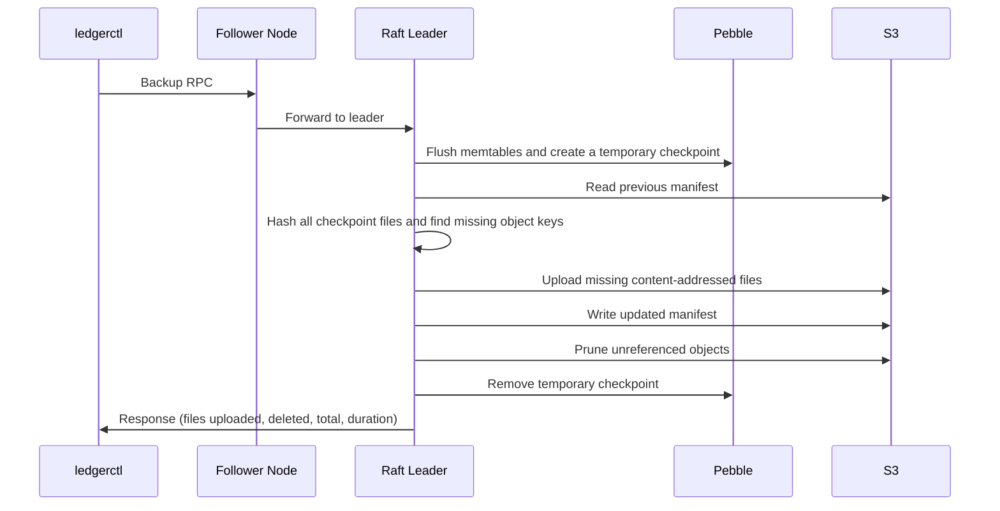

# Backup and Restore

## Overview

Each backup publishes a complete, content-deduplicated Pebble checkpoint to S3
or Azure Blob Storage. The leader flushes the Pebble memtables, creates a
checkpoint with `WithFlushedWAL`, hashes every file in its directory, uploads
missing content-addressed objects, publishes one manifest, and then prunes
objects no longer referenced by that manifest. This includes any Pebble WAL
files in the checkpoint; the Raft WAL is not a backup artifact.

A transaction confirmed before the backup's capture point is present in the
checkpoint, whether in an SST or its Pebble WAL. Transactions concurrent with
capture may be included or left for the next backup. Restore uses the latest
checkpoint directly; it does not replay incremental export segments. A manifest
with old incremental exports is rejected before staging is activated. Create a
new checkpoint backup with the new binary before relying on that destination.
This is the maintainer-approved RC artifact exception in
[the upgrade policy](./upgrades.md#release-requirement-from-v300-rc1). Keep the
source volumes through the upgrade, run a new checkpoint backup immediately
after the target starts, and verify restore from that backup before treating
the destination as protected. If the source volumes are lost before the new
checkpoint is published, the target binary cannot recover the committed
post-checkpoint delta from the old incremental artifact. No automatic
conversion of that artifact exists.

The published `IncrementalBackup` RPC and the hidden
`ledgerctl store incremental-backup` command remain compatibility aliases: they
create a full checkpoint. The RPC reports zero legacy exported segments; the
CLI prints the normal checkpoint result. New clients should call `Backup` /
`ledgerctl store backup`.

For topology and region-loss behavior, see
[Availability and Disaster Recovery](./availability-and-recovery.md).

### Storage Backends

Backups and restores support two storage backends, selected with `--driver`:

- **`s3`** (default) — Amazon S3 or any S3-compatible store (MinIO). Built with the `s3` build tag.
- **`azure`** — Azure Blob Storage. Built with the `azure` build tag. Authenticates with an account key (`--azure-account-key`) or, when omitted, `DefaultAzureCredential` (managed identity, environment, etc.). Use `--azure-endpoint` to target a non-default Blob service URL — note that **Azurite requires the account name in the path** (e.g. `http://127.0.0.1:10000/devstoreaccount1`); a bare `http://127.0.0.1:10000` will yield 400/404 responses.

All backup/restore commands accept the same provider flags; only the `--driver` value and the matching `--s3-*` / `--azure-*` flags differ.

### Scheduling with the Kubernetes Operator

The operator schedules Pebble checkpoints using the optional cron expression
`spec.schedule`. A Backup without a schedule is a template for manual runs.
Configure a scheduled Backup as follows:

```yaml
apiVersion: ledger.formance.com/v1alpha1
kind: Backup
metadata:
  name: production
spec:
  clusterRef: customer-ledger
  destination:
    driver: s3
    bucketId: customer-production
    s3:
      bucket: customer-ledger-backups
      region: eu-west-1
  schedule: "0 * * * *"
  successfulRunsHistoryLimit: 3
  failedRunsHistoryLimit: 1
```

#### CRD migration for checkpoint-only scheduling

This operator CRD change intentionally breaks the earlier RC Backup and
BackupRun resource shapes. Before installing the new CRDs, replace
`spec.schedule.full` or `spec.schedule.incremental` with the single string
`spec.schedule`. Remove `BackupRun.spec.type` and the optional
`ledger.formance.com/backup-type` label. The new status fields are
`Backup.status.lastBackup`, `lastRunCompletionTime`, and `nextBackupTime`,
and `BackupRun.status.result`; the old per-type status fields and conditions
are removed. The operator records a single `BackupHealthy` condition.
`kubectl ledger backup trigger` no longer accepts `--type`; every run creates
a checkpoint.

The old objects have no supported in-place conversion. Stop the existing
operator first, then confirm no backup Job is active. Delete any existing
BackupRun and Backup resources, install the new CRDs, and recreate Backups
from the updated manifests while the operator remains stopped. Start the new
operator only after those steps. This removes Kubernetes run history and
schedule cursors; the first scheduled checkpoint runs immediately. Ledger data
and the current object-store checkpoint are separate from these Kubernetes
resources.

#### S3 credentials for operator backups

EN-2060 requires reusable S3 credentials to stay out of ordinary `Backup`,
`BackupRun`, Job and Pod resources. For static authentication, provision an
Opaque Secret in the same namespace as the Backup and reference its keys:

```yaml
spec:
  destination:
    driver: s3
    s3:
      bucket: customer-ledger-backups
      region: eu-west-1
    s3AccessKeyIdFrom:
      name: backup-s3-credentials
      key: access-key-id
    s3SecretAccessKeyFrom:
      name: backup-s3-credentials
      key: secret-access-key
```

The operator copies only the references into non-optional `secretKeyRef`
environment entries named `S3_ACCESS_KEY_ID` and `S3_SECRET_ACCESS_KEY`. It
never reads the credential values. The kubelet resolves them when starting the
Job container; `ledgerctl` binds these existing environment inputs to the backup
storage flags and sends them in the backup RPC. The S3
values are absent from shell text and process arguments. Use the normal TLS
configuration to protect the RPC transport.

If a referenced Secret or key is missing, Kubernetes cannot start the container;
credential delivery does not silently fall back to ambient authentication. The
operator may report the run as Running while the Pod awaits its required inputs;
this is not proof of a successful backup. Updating a Secret affects newly
started containers; it does not update an already running container's environment.

Omit both references to retain the default AWS credential chain on the **Ledger
server**, which performs the upload (including its IAM/IRSA configuration).
The Job's ServiceAccount is still inherited from the Cluster, but ambient AWS
credentials in the Job are not forwarded by the backup RPC. Before the first RC, this CRD
replaces the former literal `s3AccessKeyId` and `s3SecretAccessKey` fields; update
Backup manifests to use the references when upgrading the operator and CRDs.

Each `BackupRun` uses one deterministic Job name and a controller owner reference
bound to the run UID. To keep a run attached to its actual outcome (EN-2001), the
controller first checks for a Running sibling, then persists this run as Running
before attempting Job creation. If that status write fails, it does not submit
Create. Running therefore includes provisioning and reserves the execution slot
while a creation outcome is unknown.

A timeout or connection failure after Create may mean the API server committed
the Job but its response was lost. The run remains nonterminal and Running, so
siblings continue waiting. Reconciliation retries the same name and accepts an
existing Job only when its controller owner UID matches the run. `AlreadyExists`
(including while the read cache catches up) is retryable; it never causes creation
under another name. A foreign or unowned Job is left untouched and reported as a
retryable ownership error in `BackupRun.status.message`. The run remains Running
and keeps siblings waiting; an operator must resolve the conflicting Job's
ownership or remove that Job before provisioning can resume. The controller never
adopts or deletes a foreign Job automatically. Retryable provisioning errors are
persisted in the message without rewriting unchanged diagnostics. If that status
write fails, the run stays nonterminal and reconciliation retries. The message is
cleared when the owned Job is observed still running or its result is captured.
Definitive local construction errors and API
`Invalid`/`BadRequest` creation rejections mark the run Failed; other provisioning
errors retry. Transient reads of the parent Backup or Cluster also retry rather
than ending the run during recovery. Once the owned Job completes, its outcome
and valid result payload are persisted on the run, including after a controller
restart. Pod listing, temporarily absent Pods, and fallback log opening or reading
errors leave the run Running with a diagnostic and return an error for controller
backoff. The same owned Job is reused, siblings remain blocked, and history pruning
cannot remove the nonterminal run. Unchanged diagnostics do not cause status writes.
Acquired malformed summaries and failed Jobs still mark the run Failed. A missing
result that never becomes available requires operator intervention; no new timeout
or automatic backup resubmission is introduced. Runs already marked Failed by an
older operator remain terminal.

To trigger a run directly, apply a `BackupRun` in the Backup's namespace with
`metadata.name` and `spec.backupRef`. No labels
or owner references are required. `spec.backupRef` is immutable from creation,
including Pending and completed runs; create a new run for a different parent.
For an upgrade to the checkpoint-only CRDs, follow the
[resource replacement procedure](#crd-migration-for-checkpoint-only-scheduling)
above. The historical parent-admission upgrade procedure does not apply to
these old resources because this migration deletes them.
The referenced Backup accounts for the run's
result and completion cursor, applies its history limits, and includes it in
sibling exclusion even if the association label is missing or incorrect.
The operator watches unowned manual runs for parent updates without adopting
them. Existing terminal manual runs also become visible to parent accounting
and may be pruned by the configured history limits on reconciliation.

The run history limits retain Kubernetes `BackupRun` resources only. They do
not retain historical backup artifacts or restore points in object storage.
Setting either limit to zero removes all terminal runs of that outcome without
resetting the cron schedule, including after an operator restart. The first run
is immediate; subsequent runs follow the cron expression after the latest
completed run, whether it succeeded or failed. A failed run does
not trigger an immediate retry outside the schedule.

Completion cursors and successful-result summaries persist in `Backup.status`
before history is deleted. Pending or Running runs block another scheduled
checkpoint run. See the
[scheduling contract](../technical/architecture/subsystems/backup/operator-scheduling.md)
for failure ordering and status field semantics.

### Long-Term Retention

One destination namespace (backend plus `bucket-id`) has one current restorable
checkpoint. Each successful run replaces its manifest and prunes unreferenced
objects after publication. Kubernetes `BackupRun` history limits retain only
execution records, not object-store restore points. For historical points, use
separate `bucket-id` namespaces or an archive/versioning procedure that retains
a complete manifest and every referenced object. The scheduled Backup has a
fixed `bucketId`, so rotating immutable restore points requires external
orchestration.

For operator-managed clusters without an explicit `clusterID`, the committed
random ID is the default `bucketId`. Record the source namespace for disaster
recovery and pass it explicitly when restoring into a different cluster.

## Backup

### CLI Command

```bash
# Backup to S3
ledgerctl store backup --driver s3 --s3-bucket my-bucket --s3-region us-east-1

# Backup to MinIO
ledgerctl store backup --driver s3 --s3-bucket my-bucket --s3-endpoint http://minio:9000

# Backup to Azure Blob Storage
ledgerctl store backup --driver azure --azure-account-name myaccount --azure-account-key <key> --azure-container backups
```

| Flag | Default | Description |
|------|---------|-------------|
| `--driver` | `s3` | Storage driver: `s3` or `azure` |
| `--bucket-id` | cluster-id | Namespace prefix for backup files |
| `--s3-bucket` | | S3 bucket name (required when `driver=s3`) |
| `--s3-region` | | AWS region for S3 bucket |
| `--s3-endpoint` | | Custom S3 endpoint (for MinIO) |
| `--s3-access-key-id` | | Static AWS access key ID (default: use default credential chain) |
| `--s3-secret-access-key` | | Static AWS secret access key (default: use default credential chain) |
| `--azure-account-name` | | Azure storage account name (required when `driver=azure`) |
| `--azure-account-key` | | Azure storage account key (omit to use `DefaultAzureCredential`) |
| `--azure-container` | | Azure Blob Storage container name (required when `driver=azure`) |
| `--azure-endpoint` | | Custom Azure endpoint (for Azurite) |
| `--timeout` | `1000s` | Request timeout |

### HTTP

`POST /v3/_/cluster/backups` runs the same backup with a `ledger:WriteCluster`
token:

```bash
curl -X POST http://ledger:9000/v3/_/cluster/backups \
  -H "Authorization: Bearer $TOKEN" -H 'Content-Type: application/json' \
  -d '{"storage": {"s3": {"bucket": "my-bucket", "region": "us-east-1"}}}'
```

The request returns when the backup is published. Keep the connection open
for the whole upload: a client or proxy timeout cancels the backup. See
[Backup over HTTP](../technical/architecture/subsystems/api/http-api.md#backup-over-http).

### How It Works

The `store backup` command calls the `ClusterService.Backup` gRPC RPC (unary). If connected to a follower, the request is transparently forwarded to the leader.

#### Step 1: Direct Pebble Checkpoint

The leader flushes memtables, then creates a **temporary Pebble checkpoint** — a point-in-time filesystem snapshot using hardlinks. Because boundaries (nextTransactionId, nextLogId per ledger) are written to Pebble on every committed entry, the checkpoint is immediately consistent without requiring Raft consensus or FSM gating. Backup does not block writes.

#### Step 2: Diff Against Previous Manifest

The backup reads the previous manifest from storage (if any) and computes a diff:
- **New/changed content**: Every checkpoint file is hashed; content-addressed objects absent from storage are uploaded.
- **Stale objects**: Objects absent from the new manifest are deleted only after that manifest is published.

SSTs are immutable, but files such as Pebble MANIFEST can grow under the same name. Name and size alone are not valid content identities.

#### Step 3: Upload and Manifest

New files are uploaded to the storage backend. A manifest JSON file is written last (for atomicity).

**File**: `internal/infra/backup/manager.go` — `RunBackup()`

#### Cleanup

The temporary checkpoint is removed from the leader's filesystem after the backup completes.

### Backup Preparation on Restore

Backup preparation is performed on the **restore side** (during `FinalizeRestore` or `store bootstrap`), not during backup. It resets cluster-local and checkpoint-era zones and leaves the attribute zone **byte-for-byte intact** — there is no attribute compaction, because each canonical key holds exactly one Pebble entry (no per-index history to fold):

1. **Preserve lastAppliedIndex as the genesis boundary**: The checkpoint's applied index is kept (a genesis checkpoint at index 0 gets the fallback boundary 1; MaxUint64 is refused). The restored bootstrap plants its WAL snapshot at this index, so the new log starts just above it and any fresh peer is routed through the snapshot → checkpoint-sync path (plain log replay from index 1 would land on an empty store and miss the restored state). The boundary labels the new log's start, not the source cluster's identity.
2. **Mark query-checkpoint metadata as restored**: Physical query-checkpoint directories are not part of the restored Pebble store. Surviving rows are marked `restored_from_backup`. The read-index builder uses it to keep source-cluster Raft indexes out of destination-cluster progress certificates.
3. **Wipe the cluster-transient zone**: In-flight-only tracking (e.g. running backup jobs) has no meaning on the restored cluster.
4. **Wipe the cluster-persistent zone**: One range delete removes source node/cluster identity, Raft peers, removed-member tombstones and stale Bloom blocks. The destination re-seeds its identity and membership and rebuilds Bloom from attributes. The restored genesis boundary is written back to this zone after the delete in the same batch.
5. **Clear the cache zone**: Source-cluster cache rows are not valid in the destination cluster; the restored node boots with a cold cache and re-seeds from the preserved attribute zone on first touch.

**File**: `internal/infra/attributes/prepare.go` — `PrepareForBackup()`

The audit key is a 32-byte random secret committed by Raft before the first
audit entry. Full backup is refused until it exists. A full checkpoint contains
the key; later checkpoints keep the same key and do
not change the key. Restoring A into B therefore keeps A's audit key while B
uses its own cluster ID for membership and its default backup namespace. A
later backup from B carries the same audit key under B's backup namespace.
Anyone who can read a plaintext backup can read the key and, with write access
to history, forge a new chain. Protect backup artifacts accordingly; checker
validation does not authenticate a coordinated rewrite of key and history.

### What the Backup Contains

The backup is a complete Pebble database that contains:

| Zone | Prefix | Contents |
|------|--------|----------|
| Attributes | `0x01` | Volumes, account metadata, ledger metadata, references, ledger info, boundaries |
| Cache | `0x02` | Derived/cached state |
| Per-Ledger | `0x03` | Per-ledger data (reversion bitset words, pending cleanups, mirror state) |
| History | `0x04` | Transaction logs (`{0x04, 0x01}`), audit entries (`{0x04, 0x02}`) |
| Idempotency | `0x05` | Idempotency keys |
| Global | `0x06` | Retained business and governance state: last applied timestamp, signing keys/config, sink config/cursors/status, replicated cluster config and policy, query checkpoints |
| Cluster transient | `0x07` | Backup jobs, removed on cross-cluster restore |
| Cluster persistent | `0x08` | Source applied index, node/cluster identity, Raft members and removal tombstones, Bloom blocks; removed on cross-cluster restore except for the rewritten genesis boundary |

This pre-RC change altered the physical Pebble layout. An older development store is rejected
at startup through its old boot anchor; take a new backup with the matching
binary before recovery. See the [key-by-key restore classification](../technical/architecture/subsystems/backup/README.md#global-key-lifetimes-en-1415).


### Sequence Diagram



---

## Deprecated incremental entry points

`ClusterService.IncrementalBackup` remains on the published wire surface but
runs the same checkpoint path as `ClusterService.Backup`. Its legacy export
counters are zero. `ledgerctl store incremental-backup` is a hidden alias of
`store backup` and prints the normal checkpoint result. The operator no longer
schedules incremental runs.

## Restore

### Prerequisites

- A **fresh data directory** (no existing checkpoints in `checkpoints/`). Restore mode refuses to start on an existing database.
- The server must be started with the `--restore` flag. This flag is mutually exclusive with `--bootstrap` and `--join`.

### Starting the Server in Restore Mode

```bash
ledger run --node-id 1 --cluster-id prod-ledger --data-dir ./data --restore --grpc-port 8888
```

In restore mode, only a minimal subset of the application runs:

| Started | Not Started |
|---------|-------------|
| gRPC server (RestoreService + health) | WAL, Raft Node, Transport |
| HTTP server (`/health`, plus the restore API on a loopback `--restore-listen`) | Spool, Cache, Attributes, KeyStore |
| | Admission, Controller, HealthChecker |
| | ClusterService, SnapshotService |
| | Event sinks, Signing |

**File**: `internal/bootstrap/module_restore.go` — `RestoreModule()`

### Step 1: Download

```bash
# From S3
ledgerctl restore download --s3-bucket my-bucket --s3-region us-east-1

# From Azure Blob Storage
ledgerctl restore download --driver azure --azure-account-name myaccount --azure-account-key <key> --azure-container backups
```

| Flag | Required | Description |
|------|----------|-------------|
| `--driver` | No | Storage driver: `s3` or `azure` (default: `s3`) |
| `--s3-bucket` | s3 only | S3 bucket containing the backup (required when `driver=s3`) |
| `--s3-region` | No | AWS region for S3 bucket |
| `--s3-endpoint` | No | Custom S3 endpoint (for MinIO) |
| `--s3-access-key-id` | No | Static AWS access key ID (default: use default credential chain) |
| `--s3-secret-access-key` | No | Static AWS secret access key (default: use default credential chain) |
| `--azure-account-name` | azure only | Azure storage account name (required when `driver=azure`) |
| `--azure-account-key` | No | Azure storage account key (omit to use `DefaultAzureCredential`) |
| `--azure-container` | azure only | Azure Blob Storage container name (required when `driver=azure`) |
| `--azure-endpoint` | No | Custom Azure endpoint (for Azurite) |
| `--bucket-id` | No | Namespace prefix for backup files (default: cluster-id) |
| `--poll-interval` | No | Interval between progress polls (default: 3s) |
| `--rpc-timeout` | No | Per-RPC timeout for Start, status poll, and Cancel (default: 30s) |

The client calls `RestoreService.StartDownloadBackup`, which returns a job ID
immediately and runs the actual transfer on a goroutine detached from the
calling RPC. The client then polls `RestoreService.GetDownloadStatus` on
`--poll-interval` until the job reaches a terminal state (SUCCEEDED, FAILED,
or CANCELED). Pressing `Ctrl+C` issues `RestoreService.CancelDownload` so the
staging directory is wiped before the CLI exits — the server-side goroutine
never outlives the CLI.

The server-side job:

1. Validates state (no concurrent download, no previous download already staged).
2. Creates a clean staging directory at `{dataDir}/restore-staging/`.
3. Reads the manifest from S3 and downloads the checkpoint files in parallel
   through an `errgroup` worker pool. The pool size is set by the server flag
   `--restore-download-parallelism` (default 16, clamped to `[1, 64]`).
   Every checkpoint file must match the size recorded in the manifest and the
   sha256 embedded in its object key. A mismatch fails the job
   (`DOWNLOAD_STATE_FAILED`) with an error that names the file, and the
   staging directory is wiped.
4. Opens the complete checkpoint in staging. Per-replica read indexes are rebuilt by each node from the restored primary-store registry; see [Restore Lifecycle](../technical/architecture/subsystems/indexer/indexes.md#restore-lifecycle).
5. On success, marks the staging as ready.

If the job fails or is cancelled, the staging directory is wiped so the
operator can retry with a fresh state without restarting the server.

The transfer is detached from the initiating RPC, not from the restore-mode
application. After any configured shutdown grace period, restore shutdown
rejects new restore RPCs and HTTP requests and cancels any active download,
stops the HTTP server and then gRPC, joins admitted RPCs and the download job, and finally
closes the retained staging Pebble store. Explicit
`CancelDownload` keeps its client-facing behavior: it cancels only the selected
job, waits for a bounded drain, and leaves the restore-mode application running
so the operator can retry.

The join includes failed/canceled-job staging cleanup. Storage-client
initialization and local filesystem operations do not accept the download
context, so their stop hook may still be waiting when the service runner
enforces `--total-stop-timeout`. That budget includes `--grace-period` and all
Fx stop hooks. Deadline expiry returns a shutdown error and an unsuccessful
command exit without guaranteeing that every hook completed. Process exit can
therefore interrupt cleanup and leave staging files or an uncleanly closed
staging store. Cleanup runs after the Fx lifecycle. After a
termination signal it uses the remaining signal-time deadline, distinct from
the normal Fx stop budget; expiry or finalization failure exits unsuccessfully.
See [server termination](cli.md#server-termination) for startup-unwind and zero
timeout behavior. Staging-store close errors are logged under the existing close
policy and are not returned by the restore stop hook.

### Step 2: Validate (Required for gRPC Finalization)

Checker validation is an operator-invoked integrity check, outside the normal
request-processing path. During restore it checks the staged data before it
becomes live: `restore validate` invokes it through the restore-mode server's
gRPC API, while offline `store bootstrap --validate` runs it without a server.
It is a prerequisite of `FinalizeRestore`.

For recovery and restore drills, run validation after checkpoint download completes, before finalization. Investigate any reported integrity errors
before proceeding. The numbered workflow is the recommended operational
sequence; the server enforces successful validation before gRPC finalization.

```bash
ledgerctl restore validate
```

| Flag | Required | Description |
|------|----------|-------------|
| `--timeout` | No | Request timeout (default: 50s) |

Calls `RestoreService.ValidateRestore` (server-streaming). The server opens the staging directory as a read-only Pebble database and runs the full integrity checker (`check.Checker`). For each projection its passes cover, the checker re-derives the expected state from the audit chain and compares it with what the staging store holds. The passes cover the audit hash chain, log sequence continuity, volumes per `(ledger, account, asset, color)` (each color bucket is checked separately), metadata, transaction state, reversions, idempotency outcomes, the index registry and signing keys; see [Checker](../technical/architecture/subsystems/checker/checker.md#the-verification-passes) for the complete list. A successful validation says nothing about the fields the checker does not verify, such as transaction `insertedAt` / `updatedAt` in ledger-log payloads, per-replica index version state and read-index contents; see [What is not verified](../technical/architecture/subsystems/checker/checker.md#what-is-not-verified).

Progress events (percentage) and error events are streamed back to the client in real time.

> **This is the same checker used by `ledgerctl store check` during normal operations.**

### Step 3: Preview

```bash
ledgerctl restore preview
```

| Flag | Required | Description |
|------|----------|-------------|
| `--timeout` | No | Request timeout (default: 10s) |

Calls `RestoreService.PreviewRestore` (unary). Returns a summary of the staged data:

- Last applied index and timestamp
- Last log sequence
- Number of ledgers and their names

### Step 4: Finalize

```bash
# With confirmation prompt
ledgerctl restore finalize

# Skip confirmation
ledgerctl restore finalize --yes
```

| Flag | Required | Description |
|------|----------|-------------|
| `--yes`, `-y` | No | Skip confirmation prompt |
| `--timeout` | No | Request timeout (default: 10s) |

Calls `RestoreService.FinalizeRestore` (unary). This commits the staged backup as live data.

`FinalizeRestore` does not run Checker itself, but requires a prior successful
`ValidateRestore` call for the currently staged backup. Use:

```bash
ledgerctl restore validate && ledgerctl restore finalize
```

Finalization performs these steps:

1. Prepares the staged store ([Backup Preparation on Restore](#backup-preparation-on-restore): applied index preserved as the genesis boundary, persisted config/bloom/peers/cache reset).
2. Reads back `lastAppliedIndex` and `lastAppliedTimestamp` from the prepared store.
3. Closes the staging Pebble handle, creates `{dataDir}/checkpoints/`, and removes any existing `checkpoints/0` path.
4. Hard-links staging into a temporary checkpoint directory, then renames it to `{dataDir}/checkpoints/0`.
5. Writes the **RESTORED marker** JSON file to `{dataDir}/RESTORED`. The marker is the commit point and is written only after checkpoint placement.
6. Removes the staging directory. A cleanup failure is logged after success; the published checkpoint and marker remain valid.

One finalization owns the staged generation from preparation through publication and cleanup. A concurrent call fails with `FailedPrecondition` without changing the owner's staging or checkpoint. A repeated call after success also fails because the staging handle is gone; it does not return success again. Shutdown waits for an admitted finalizer before closing restore resources.

If preparation fails, the staging handle remains open and the marker is absent; the staged bytes may already have changed if Pebble committed before reporting an error. If publication fails after the handle closes, staging files remain but cannot be finalized again in the same server process. A marker-write failure removes the newly placed checkpoint; if that rollback fails, remove the leftover checkpoint manually. Restart restore mode with a fresh target and repeat download and validation before retrying. Never treat a failed finalization as a committed restore.

### Restore over HTTP

On the default loopback `--restore-listen`, the restore HTTP API runs the same
stages without `ledgerctl`, for example from inside the pod:

```bash
BASE=http://127.0.0.1:9000/v3/_/restore
curl -si -X POST $BASE/downloads -H 'Content-Type: application/json' \
  -d '{"storage": {"s3": {"bucket": "my-bucket", "region": "us-east-1"}}}'
curl -s $BASE/downloads/<jobId>          # poll until DOWNLOAD_STATE_SUCCEEDED
curl -sN -X POST $BASE/validate -H 'Content-Type: application/json' -d '{}'   # last line: {"result":{"passed":true}}
curl -s $BASE/preview
curl -s -X POST $BASE/finalize -H 'Content-Type: application/json' -d '{}'
```

`DELETE $BASE/downloads/<jobId>` cancels a download. The routes have no
authentication. They refuse browser requests (a non-loopback `Host`, an
`Origin` or a cross-site `Sec-Fetch-Site` header), and every POST must send
`Content-Type: application/json`. A download with a custom storage `endpoint`
must carry explicit keys (`accessKeyId` and `secretAccessKey`, or
`accountKey`); ambient credentials apply only to the provider's default
endpoint. With a non-loopback `--restore-listen`, HTTP serves `/health`
only; use `ledgerctl restore` against the gRPC service with TLS. See
[Restore mode HTTP API](../technical/architecture/subsystems/api/http-api.md#restore-mode-http-api).

On next startup, `ScanLatestCheckpointID()` scans the `checkpoints/` directory for the highest numbered subdirectory to find the active checkpoint.

After finalize, the server stays running but refuses new uploads. Restart without `--restore` to use the restored data.

### Data Flow

```
Client                       Restore Server                    Disk / S3
  |                               |                               |
  |--- StartDownloadBackup ------>|                               |
  |    (S3 params)                |--- spawn job goroutine        |
  |<-- {jobId} -------------------|                               |
  |                               |--- parallel Download (N) ---->|
  |--- GetDownloadStatus -------->|    {dataDir}/restore-staging/ |
  |<-- {state, files, bytes} ----|                               |
  |    (poll every 3s)            |                               |
  |--- GetDownloadStatus -------->|                               |
  |<-- {SUCCEEDED} ---------------|                               |
  |                               |                               |
  |--- ValidateRestore ---------->|                               |
  |    (stream events)            |--- check.Checker.Check() ---->|
  |<-- progress/error ------------|    (read-only staging DB)     |
  |                               |                               |
  |--- PreviewRestore ----------->|                               |
  |<-- summary -------------------|--- OpenReadOnly(staging) ---->|
  |                               |                               |
  |--- FinalizeRestore ---------->|                               |
  |                               |--- HardLink staging --------->|
  |                               |    -> checkpoints/0           |
  |                               |--- Write RESTORED marker ---->|
  |                               |--- Remove staging ----------->|
  |<-- response ------------------|                               |

   On Ctrl+C while polling:
  |--- CancelDownload ----------->|                               |
  |                               |--- cancel job ctx             |
  |                               |--- wipe restore-staging/      |
  |<-- ack ----------------------|                               |
```

---

## Offline Bootstrap

An alternative to the 4-step gRPC restore flow. The `store bootstrap` command builds a ready-to-use data directory by downloading backup files directly from S3 or Azure Blob Storage — no server required.

### CLI Command

```bash
ledgerctl store bootstrap --driver s3 --s3-bucket my-bucket --s3-region us-east-1 --data-dir ./fresh-data [--validate] [--yes]
```

| Flag | Default | Description |
|------|---------|-------------|
| `--driver` | `s3` | Storage driver: `s3` or `azure` |
| `--s3-bucket` | | S3 bucket containing the backup (required when `driver=s3`) |
| `--s3-region` | | AWS region for S3 bucket |
| `--s3-endpoint` | | Custom S3 endpoint (for MinIO) |
| `--s3-access-key-id` | | Static AWS access key ID (default: use default credential chain) |
| `--s3-secret-access-key` | | Static AWS secret access key (default: use default credential chain) |
| `--azure-account-name` | | Azure storage account name (required when `driver=azure`) |
| `--azure-account-key` | | Azure storage account key (omit to use `DefaultAzureCredential`) |
| `--azure-container` | | Azure Blob Storage container name (required when `driver=azure`) |
| `--azure-endpoint` | | Custom Azure endpoint (for Azurite) |
| `--bucket-id` | | Namespace prefix for backup files (default: uses cluster-id from config) |
| `--data-dir` | | Target data directory (required, must be fresh) |
| `--validate` | `false` | Run Checker after checkpoint download and before finalization; abort on validation failure |
| `-y, --yes` | `false` | Skip confirmation prompt |

### How It Works

1. **Fresh directory guard**: Rejects a `RESTORED` marker, live database or incompatible checkpoint layout. A lone unmarked `checkpoints/0` from interrupted finalization is reclaimed before downloading.
2. **Download**: Reads the manifest from the configured backend, creates or opens the selected data directory, then inspects `restore-staging/` with rooted `Lstat`. An existing symlink (even to a target inside the data directory) or non-directory is rejected. Any old real staging directory is removed through the data-directory root before a fresh directory is created and opened. Downloads checkpoint files sequentially through a filesystem root opened on staging. Each manifest filename is converted from slash-separated form and must be lexically local before parent creation, object lookup or file creation for that entry. Rooted parent and file creation reject symlink escapes. Each checkpoint file is verified against its manifest size and the sha256 in its object key; a mismatch aborts bootstrap and names the file. An export-only manifest is rejected before staging.
3. **Preview**: Opens the staging as a read-only Pebble database, reads metadata (last applied index, timestamp, ledger list), and displays a summary table.
4. **Validate** (optional): If `--validate` is set, runs the full integrity checker (`check.Checker`) -- the same checker used by `store check` and `restore validate`. Execution failures or reported integrity errors abort bootstrap before confirmation, preparation, and finalization. Without this flag, bootstrap skips Checker entirely.
5. **Confirm**: Unless `--yes` is set, prompts for user confirmation.
6. **Prepare**: Clears source cluster identity, peers, backup jobs and cache; drops persisted Bloom blocks; and writes the checkpoint's applied index back as the destination genesis boundary (the restored genesis' WAL-snapshot index). Global business and governance state and the attribute zone remain intact.
7. **Finalize**: After closing the prepared store and rereading its metadata, hard-links staging into a temporary checkpoint directory and renames it to `{data-dir}/checkpoints/0`. Only then writes the atomic `RESTORED` commit marker. A marker-write failure attempts to remove the placed checkpoint; remove it manually if rollback fails.
8. **Cleanup**: Removes the staging directory. A cleanup error is reported as a warning after the restore has committed.

Use the target directory exclusively while this offline command runs. Every
attempt discards prior staging before downloading checkpoint files, including
after an incomplete attempt. This prevents stale files from a prior attempt
from mixing with the current checkpoint. Reset failure aborts before publication;
old staging may be partly removed or absent. A download failure can leave
partially downloaded staging. Validation failure or EOF at confirmation leaves
a fully downloaded but unprepared checkpoint. A preparation failure may leave
partially prepared staging. None of these states is activated; the next
invocation resets staging again. An explicit negative
confirmation instead attempts to remove staging. The existing freshness and
`RESTORED` marker guards still apply: retries do not repair an already finalized
restore.

The download roots close before preview, validation, confirmation
and finalization. Download rejection is per entry: earlier files and partial
bytes can remain after an error, with no immediate cleanup. A failed download
reaches none of the later steps. Size/hash verification detects object corruption;
it does not authenticate manifest filenames or replace destination confinement.

Use `--validate` for recovery and restore drills so integrity checks succeed
before the data is finalized. Its default of `false` makes it opt-in; successful
bootstrap without this flag is not evidence that Checker passed.

### When to Use

- **Scripted disaster recovery**: No need to start a server in `--restore` mode.
- **CI/CD pipelines**: Single command, non-interactive with `--yes`.

For the gRPC-based flow with S3 download and remote validation, see the [Restore](#restore) section above.

### Example

```bash
# ── On a fresh machine ──

# 1. Bootstrap from S3 backup (with validation)
ledgerctl store bootstrap --driver s3 --s3-bucket my-bucket --s3-region us-east-1 --data-dir ./fresh-data --validate --yes

# Or from Azure Blob Storage
ledgerctl store bootstrap --driver azure --azure-account-name myaccount --azure-account-key <key> --azure-container backups --data-dir ./fresh-data --validate --yes

# 2. Start the server normally
ledger run --node-id 1 --cluster-id prod-ledger --data-dir ./fresh-data --bootstrap --wal-dir ./fresh-wal --grpc-port 9999
```

**File**: `cmd/ledgerctl/store/bootstrap.go`

---

## Post-Restore Bootstrap

After finalize (either via `restore finalize` or `store bootstrap`), restart the server in normal mode:

```bash
ledger run --node-id 1 --cluster-id prod-ledger --data-dir ./data --bootstrap --wal-dir ./wal --grpc-port 8888
```

On startup, the node detects the `RESTORED` marker in `NewNode()`:

1. WAL is empty (first start) AND `RESTORED` marker exists:
   - Calls `fsm.RecoverState()` to recover in-memory FSM counters from Pebble:
     - `nextLedgerID` from the highest existing ledger ID
     - `nextSequenceID` from the last log sequence
     - `lastAuditHash` and `nextAuditSequenceID` from the last audit entry
   - Creates an FSM snapshot (`fsm.CreateSnapshot()`)
   - Creates a WAL snapshot at `marker.LastAppliedIndex` with `ConfState{Voters: [nodeID]}` (single-node bootstrap); a marker carrying 0 is refused — the snapshot must sit above the log start so joiners are forced through checkpoint sync
   - Removes the RESTORED marker
   - Continues with normal Raft startup

2. WAL is empty AND no marker: falls through to normal bootstrap/join logic.

This ensures the Raft index is properly aligned with the restored data.

### RESTORED Marker

The `RESTORED` file is a JSON file written to the data directory during `FinalizeRestore`:

```json
{
  "lastAppliedIndex": 8500,
  "lastAppliedTimestamp": 1700000000000000
}
```

- `lastAppliedIndex`: The Raft index the restored genesis occupies in the new log — the checkpoint's applied index preserved by backup preparation (1 for a genesis checkpoint, never 0). The restored bootstrap creates its WAL snapshot at this index. It labels the restored checkpoint in the destination log.
- `lastAppliedTimestamp`: The HLC timestamp (microseconds) of the last applied entry.

**File**: `internal/infra/node/restored_marker.go`

---

## Safety Guarantees

| Guarantee | Mechanism |
|-----------|-----------|
| **Consistent snapshot** | Backup checkpoint is created as a direct Pebble checkpoint. Boundaries are always up-to-date in Pebble (written on every commit), so the checkpoint is consistent without Raft consensus or FSM gating. |
| **Content deduplication** | Every checkpoint file is hashed; identical content is reused, and unreferenced objects are pruned after manifest publication. |
| **Self-contained on restore** | During restore finalize, the applied index is preserved as the genesis boundary and persisted config and bloom blocks are reset (Global-zone); the attribute zone is preserved byte-for-byte. The new log's index space starts at the boundary; nothing depends on the original cluster's later Raft indices. |
| **Data integrity (content)** | `ValidateRestore` runs the full integrity checker: log sequence continuity, volume balance verification, metadata consistency. |
| **Fresh directory required** | Restore mode refuses to start if existing checkpoints are found in `checkpoints/`, preventing accidental overwrites. |
| **Atomic finalize** | Checkpoint placement uses `HardLink()` (temp directory + atomic `os.Rename`) for crash safety. |
| **Idempotent marker** | The RESTORED marker is consumed exactly once on the next normal boot, then deleted. |
| **No data loss** | The original cluster is unaffected by the restore operation. Backup is a read-only operation on the source cluster. |

---

## Complete Example

```bash
# ── On the running cluster ──

# 1. Create a backup to S3
ledgerctl store backup --driver s3 --s3-bucket my-bucket --s3-region us-east-1

# ── On a fresh server ──

# 2a. OPTION A: Offline bootstrap (no server needed, downloads from S3)
ledgerctl store bootstrap --s3-bucket my-bucket --s3-region us-east-1 --data-dir ./fresh-data --validate --yes
ledger run --node-id 1 --cluster-id prod-ledger --data-dir ./fresh-data --bootstrap --wal-dir ./fresh-wal --grpc-port 9999

# 2b. OPTION B: Online restore (4-step gRPC flow, downloads from S3)
ledger run --node-id 1 --cluster-id prod-ledger --data-dir ./fresh-data --restore --grpc-port 9999
ledgerctl --server localhost:9999 restore download --s3-bucket my-bucket --s3-region us-east-1
ledgerctl --server localhost:9999 restore validate
ledgerctl --server localhost:9999 restore finalize --yes
# Stop restore server, then restart normally:
ledger run --node-id 1 --cluster-id prod-ledger --data-dir ./fresh-data --bootstrap --wal-dir ./fresh-wal --grpc-port 9999
```

---

## Files

| File | Description |
|------|-------------|
| **Backup** | |
| `cmd/ledgerctl/store/backup.go` | `store backup` CLI command |
| `cmd/ledgerctl/store/incremental_backup.go` | `store incremental-backup` CLI command |
| `internal/adapter/grpc/server_cluster.go` | `ClusterService.Backup` gRPC implementation |
| `internal/infra/backup/manager.go` | `RunBackup()` — diff, upload, manifest |
| `internal/infra/backup/s3.go` | S3 storage driver |
| `internal/infra/backup/storage.go` | Storage interface and driver factory |
| `internal/infra/attributes/prepare.go` | `PrepareForBackup()` — source cluster-local zone and cache reset during restore |
| **Restore (gRPC)** | |
| `misc/proto/restore.proto` | RestoreService proto definition |
| `internal/proto/restorepb/` | Generated proto code |
| `internal/adapter/grpc/server_restore.go` | RestoreService gRPC implementation |
| `internal/bootstrap/module_restore.go` | Minimal fx module for restore mode |
| `internal/pkg/tarutil/extract.go` | Shared tar extraction utility |
| `internal/storage/dal/store_readonly.go` | Read-only Pebble store opener |
| **Offline Bootstrap** | |
| `cmd/ledgerctl/store/bootstrap.go` | `store bootstrap` CLI command (offline) |
| **Post-Restore Bootstrap** | |
| `internal/infra/node/restored_marker.go` | RESTORED marker read/write/remove |
| `internal/infra/state/machine.go` | `RecoverState()` — FSM state recovery from Pebble |
| **Integrity Checker** | |
| `internal/application/check/checker.go` | Hash chain, volumes, metadata verification |
