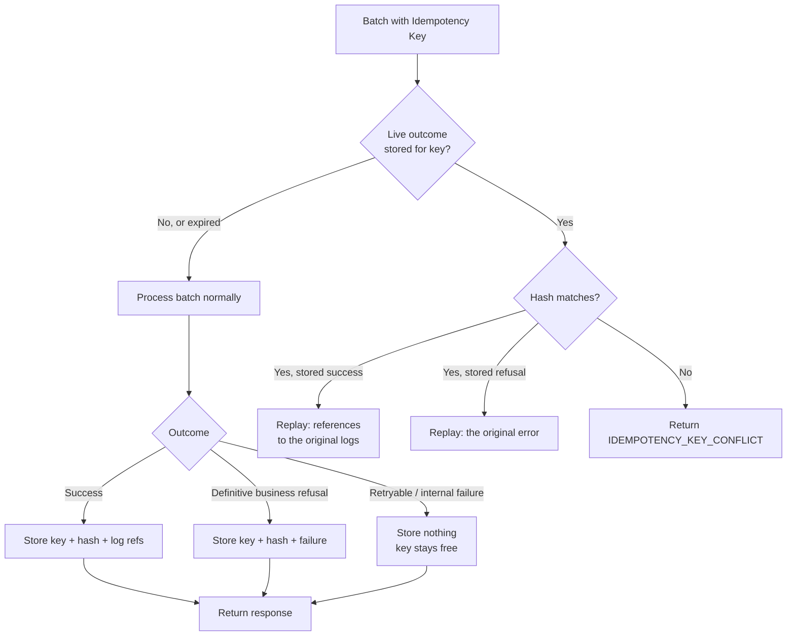
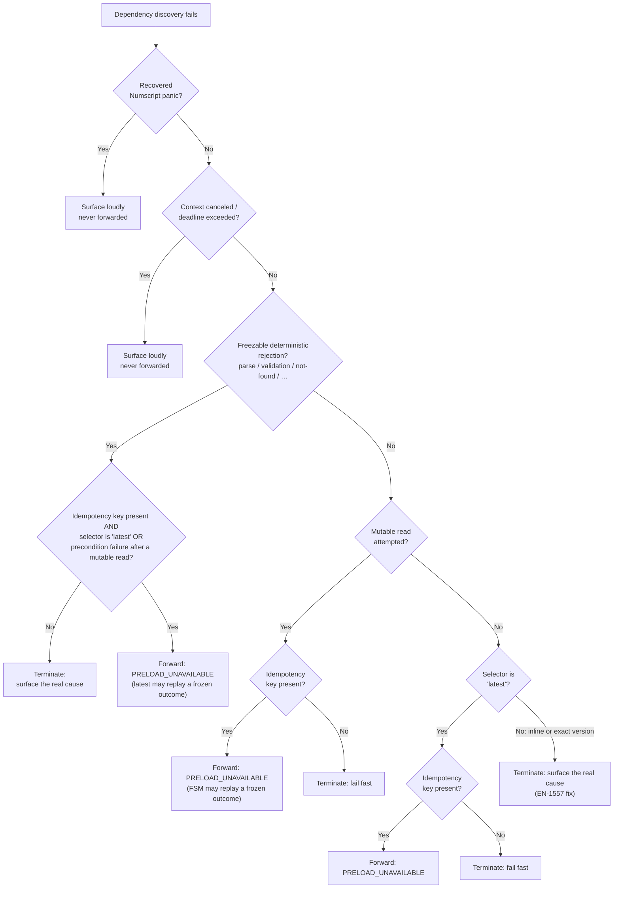

# Idempotency Keys

## Overview

Idempotency keys let a client retry a request safely. The first time a batch carrying a key is applied, the FSM records the batch's **outcome** against the key. Every later batch with the same key and the same content, within the TTL, gets that outcome back without being executed again.

The recorded outcome is either a success or a **definitive business refusal** (for example `INSUFFICIENT_FUNDS`). A key is therefore not a lock that only a committed transaction can take: a refused batch holds its key too, and a retry replays the original error instead of re-executing against state that has changed since. See [Stored refusals](#stored-refusals).

Idempotency keys are stored under the dedicated `ZoneIdempotency` zone (`0x05`) with an in-memory bridge map for inter-proposal visibility. They are not part of the shared attribute/cache system.

## Key Characteristics

| Characteristic | Description |
|----------------|-------------|
| **Scope** | System-level (not per-ledger) |
| **Uniqueness** | Keys must be globally unique across all ledgers |
| **Unit** | One key per atomic batch (`ApplyBatch.idempotency_key`), never per individual request |
| **Recorded outcome** | A success (references to the committed logs) or a definitive business refusal (the original error) |
| **Hash verification** | The batch content is hashed (BLAKE3) to detect conflicts |
| **Persistence** | Stored under `{0x05, 0x01}` (`ZoneIdempotency` + `SubIdempKeys`) with a time index at `{0x05, 0x02}` (`ZoneIdempotency` + `SubIdempTimeIdx`) |
| **TTL** | Set by the Raft-replicated cluster policy (default: 24h, 0 = no expiration); frozen per outcome as an absolute `expires_at` at write time. Successes and refusals share the same TTL |
| **Eviction** | Deterministic cleanup via Raft `IdempotencyEviction` commands |

## How It Works

### Request Flow



Requests rejected by admission never reach the FSM, so they never reach this flow and never hold a key. See [Stored refusals](#stored-refusals).

### Hash Computation

When processing a batch with an idempotency key:

1. **Hash computation**: The batch's ordered requests (excluding the idempotency key itself and technical fields) are hashed using BLAKE3 (`HashProposal`).
2. **Storage**: The idempotency key maps to an `IdempotencyKeyValue` (`misc/proto/common.proto`):

| Field | Meaning |
|-------|---------|
| `first_log_sequence` | Sequence of the first log the batch committed (success only) |
| `log_count` | Number of contiguous logs the batch committed; `0` when `failure` is set |
| `hash` | BLAKE3 hash of the batch content |
| `hash_version` | Hash algorithm version |
| `created_at` | HLC microseconds, from the Raft entry |
| `failure` | Set instead of the log refs when the first apply was a definitive business refusal: typed `reason`, client-facing `message` and error `metadata` |
| `expires_at` | Absolute HLC-microsecond expiry, frozen from the committed policy TTL (`created_at + ttl`; 0 = never) |

### Behavior Matrix

| Scenario | Result |
|----------|--------|
| New idempotency key | Process normally; store the outcome (success or definitive refusal) |
| Same key + same content (within TTL), stored success | Return references to the original logs |
| Same key + same content (within TTL), stored refusal | Return the original error again, without re-executing |
| Same key + different content (within TTL) | Return `IDEMPOTENCY_KEY_CONFLICT`, whatever the stored outcome |
| Same key (after TTL expiration) | Process normally (key treated as new) |
| First attempt failed with a retryable or internal error | Nothing stored: the next batch under the key is processed normally |
| First attempt rejected by admission | Nothing stored: the next batch under the key is processed normally |
| No idempotency key | Process normally, no idempotency tracking |

## Stored refusals

`Machine.recordIdempotencyFailure` (`internal/infra/state/machine.go`) stores a refusal against the key when the FSM rejects the batch with an error whose kind passes `domain.IsFreezableFailure` (`internal/domain/errors.go`): `KindValidation`, `KindNotFound`, `KindAlreadyExists`, `KindConflict` or `KindPrecondition`. The reason-to-kind mapping is `domain.KindForReason` (`internal/domain/reason.go`).

| Outcome | Holds the key? | Examples |
|---------|----------------|----------|
| Committed success | Yes | |
| Business refusal raised by the FSM | Yes | `INSUFFICIENT_FUNDS`, `NUMSCRIPT_EXECUTION_ERROR`, `VOLUME_OVERFLOW`, account-type violations, `TRANSACTION_REFERENCE_CONFLICT`, `TRANSACTION_ALREADY_REVERTED`, `LEDGER_NOT_FOUND` |
| Rejected by admission, before the batch is proposed | No | Malformed request, account/asset/metadata shape, metadata size limits, Numscript parse errors, auth errors. See [Validation — Admission vs FSM](validation.md) |
| Retryable or internal failure | No | `PRELOAD_UNAVAILABLE`, `BALANCE_NOT_PRELOADED`, maintenance mode, cluster unhealthy, index building, timeouts, internal errors |

Rules that follow from this:

- **The whole batch shares one outcome.** If one request in an atomic batch is refused, the whole batch is refused and the key holds that refusal.
- **A replayed refusal is not re-recorded**, so its expiry is not reset. A live stored outcome is never overwritten.
- **There is no opt-out.** No per-request, per-ledger or cluster setting keeps a business refusal from holding its key.
- **To retry after a business refusal, use a new key.** Retrying under the same key, even after the cause is fixed (for example after funding the account), replays the original refusal until the key expires.

### Keys versus transaction references

A transaction `reference` behaves differently, and is the right tool when only one writer may take a given slot:

| | Idempotency key | Transaction reference |
|---|---|---|
| Taken by | Success **or** definitive refusal | Committed transaction only |
| Scope | Whole cluster, all ledgers | One ledger |
| Lifetime | TTL (default 24h) | Permanent |
| Reuse with a different body | `IDEMPOTENCY_KEY_CONFLICT` | `TRANSACTION_REFERENCE_CONFLICT`, with `existingTransactionId` in the error metadata |

A refused transaction does not take its reference: the reference is written only on the success path (`processor_transaction.go`), and the proposal's write set is rolled back on failure. A common pattern is to put the slot in the reference and use one idempotency key per attempt.

### Inspecting a key

There is no dedicated lookup RPC. Every FSM-applied batch, success or refusal, writes an audit entry carrying the batch's idempotency key, and the audit is indexed by key:

```bash
ledgerctl audit list --filter 'idempotency_key == "K"'
```

The gRPC equivalent is `ListAuditEntries` with the same filter. Read the result with these rules:

- Each entry carries the key and its frozen `expires_at`.
- The entry that holds the key is the **first** entry for that key within the TTL window. A later `IDEMPOTENCY_KEY_CONFLICT` is audited as a fresh refusal, so it also appears with the key, but it never replaces the stored outcome.
- Replays of the stored outcome write no audit entry.
- The audit keeps entries after their key has expired.
- Batches rejected by admission write no entry, and hold no key either.

## Historical outcomes and checkpoint readiness

The FSM marks a replay explicitly in its transient `ApplyResult`. Admission
resolves the historical log references and retains that `Replayed` flag in
`domain.ApplyResult`; controllers must preserve both. The flag changes neither
persisted state nor business intent. The gRPC forwarding response carries it
as server-produced metadata so a follower cannot mistake a replay for a new
execution.

A replay is evidence of the original committed outcome, not a current resource
read. In particular, checkpoint-create retries return their historical success
after deletion and while the original call is still waiting for materialization.
They do not wait again or recreate anything. New creations retain the
[checkpoint lifecycle wait](../read-path/query-checkpoints.md#readiness-and-error-contract).

## Numscript Dependency-Resolution Failures

Idempotency keys also govern a narrower, forward-vs-terminate decision admission has to make while *preparing* a `CreateTransaction` order that references a Numscript script. Before a script's order can be proposed, admission statically discovers the accounts, assets, and metadata it depends on (`DiscoverNumscriptDependencies`, `internal/domain/processing/numscript/discover.go` — see [Numscript Library](../scripting/numscript-library.md)) so the FSM never has to touch Pebble to resolve them. When that discovery fails, admission must decide whether the failure is **deterministic** — the script could never have succeeded, no matter how many times it is retried — or **state-dependent** — current state caused it, and a different (or later) state might not. `Admission.classifyResolutionFailure` (`internal/application/admission/admission.go`) makes this call from two signals Ledger already owns; it never inspects error strings or Numscript internals. The error's kind refines one case: `convertNumscriptError` maps the library's public resolver error types to `ErrNumscriptExecution` (`NUMSCRIPT_EXECUTION_ERROR`, `KindPrecondition`) when the script, its vars, or the state it read caused the failure.

### The two signals

1. **Selector mutability.** Under the numscript-library versioning model (see [Version Resolution](../scripting/numscript-library.md#version-resolution)), a script reference is either an exact immutable semver, the literal `latest`, or an inline script body. A `latest` reference can resolve to a *different, previously-saved* version on a later attempt, so a `latest` failure stays forwardable under an idempotency key even when the currently-selected version failed before reading any state. An inline script or an exact pinned version is deterministic: the same input always produces the same failure.
2. **Read-attempt provenance.** `RecordingStore.MutableReadAttempted()` (`internal/domain/processing/numscript/store.go`) reports whether resolution delegated any balance/metadata lookup to the inner store before failing — **including a lookup that itself returned an error**. This is carried out of `DiscoverNumscriptDependencies` through the typed `DependencyResolutionError` (`internal/domain/processing/numscript/resolution_error.go`). The pre-existing `RecordingStore.ReadNothing()` is insufficient for this purpose: it reflects only *successfully recorded* values, so it cannot distinguish "no read was attempted" from "a read was attempted and failed" — exactly the case that matters here.

### Decision flow



A recovered Numscript panic and context cancellation/deadline are surfaced loudly and never softened to `PRELOAD_UNAVAILABLE` — they are "should not happen" or host-level conditions (invariant #7), not business outcomes with a frozen replay to preserve. A freezable deterministic rejection (parse error, validation failure, not-found, already-exists, …) is likewise terminal: there is nothing a retry could change — *except* for a `latest` reference under an idempotency key, where the resolved content can differ from the version that froze an outcome on the original attempt (the idempotency hash binds the reference `name`+`latest`, not the resolved content), so that one case falls through to the forward path for the FSM to replay.

Asset scaling (`… with scaling through …`) is a special member of that freezable class worth calling out: resolution rejects it unconditionally, independent of any balance/metadata, so it is deterministic — yet a `balance()`/`meta()` var origin bound *before* the scaling statement is walked will already have set the read-attempt flag. `convertNumscriptError` therefore maps the one publicly-exposed deterministic sentinel (`numscriptlib.ErrScalingNotSupported`) to the freezable `ErrNumscriptScalingUnsupported` (`KindValidation`), so the freezable guard above terminates it *before* the provenance signals below are consulted (for an inline or exact reference; a `latest` reference under a key forwards instead, per the freezable carve-out above). Without this, a read-then-scaling inline/exact script under an idempotency key would be forwarded as `PRELOAD_UNAVAILABLE` and retried forever (EN-1557).

A Numscript execution failure (`NUMSCRIPT_EXECUTION_ERROR`) is freezable but `KindPrecondition`: amounts, portions, accounts and assets can come from `balance()` or `meta()`, so the same script and vars may succeed against other state. Under an idempotency key, one raised after a mutable read therefore skips the freezable termination and reaches the provenance branch, which forwards it. Terminating it would deny the replay of a key whose original attempt succeeded before the state changed (for example a `meta()`-referenced key deleted since). Without a key, or without a mutable read, it terminates on the execution error itself.

Past those guards, the provenance signals decide. A mutable read attempted before failing — even one that itself errored — means the failure is state-dependent. A *forced* balance query is not such a read: under force the resolver's store short-circuits to a synthetic max without consulting the value source, so it never sets the read-attempt flag (metadata reads consult real state even under force and still do); this keeps a forced `balance()` origin followed by a deterministic error from being misclassified as state-dependent and forwarded into an indefinite retry loop. When the failure is genuinely state-dependent: with an idempotency key, the order is stamped `PreloadUnavailable` on its `OrderTechnical` (the one field invariant #10 permits mutating post-acceptance) and forwarded, so the FSM can replay a frozen outcome if the batch is a retry, or reject with the retryable, non-frozen `ERROR_REASON_PRELOAD_UNAVAILABLE` if it isn't. Without a key there is no frozen outcome to preserve, so admission fails fast instead.

When no mutable read was attempted, only a `latest` selector keeps the same forwarding behavior, because a later attempt could still resolve to a different saved version. An inline script or an exact immutable version with no attempted read is fully deterministic — this is the case the EN-1557 fix changed: it previously forwarded as a retryable `PRELOAD_UNAVAILABLE` with no frozen outcome to ever converge on, producing an unbounded retry loop. It now terminates immediately, surfacing the real Numscript cause.

## TTL and Eviction

### Configuration

| Flag | Default | Description |
|------|---------|-------------|
| `--idempotency-ttl` | `24h` | Seeds the *desired* idempotency TTL in the cluster policy (0 = no expiration) |
| `--idempotency-eviction-interval` | `60s` | How often the leader proposes eviction |

`--idempotency-ttl` is node-local admission-side configuration: it names the desired TTL that the reconciler proposes into the Raft-replicated [cluster policy](../fsm/deterministic-fsm.md#35-raft-replicated-cluster-policy). The FSM never reads the flag during apply. Instead, each apply freezes the outcome's absolute `expires_at` once, from the TTL in the committed policy (`FSMState.ClusterPolicy.IdempotencyTtlMicros`), as `created_at + ttl` (0 = never; overflow saturates). Because the expiry is stamped from committed state and stored on the outcome, every node computes the same value and the expiry decision (`IsExpired`) reads no node-local configuration — the FSM-determinism requirement. Changing the TTL is a cluster-policy revision bump, not a boot-config change, so it needs no `--unsafe-skip-config-validation`.

### Eviction Mechanism

Expired idempotency keys are cleaned up via a dedicated Raft command (`IdempotencyEviction`):

1. The leader periodically takes `cutoff = now` (wall-clock) and scans the time index — keyed by `expires_at` — for entries whose `expires_at <= cutoff`, embedding their key hashes in the proposal
2. All nodes apply the eviction deterministically: delete exactly the pre-scanned hashes from the in-memory map + Pebble, guarding against evicting a still-live or never-expiring entry named by a stale scan
3. The cutoff and hashes are embedded in the Raft proposal, so all nodes agree on exactly what to evict and the apply path performs no Pebble reads
4. No race conditions: eviction is serialized with business proposals in the FSM

### Memory Bounds

The in-memory map grows between eviction commands and shrinks on each eviction:
- With interval=60s and 1000 IK/s: ~60K entries x ~80B = ~5MB
- With interval=60s and 10K IK/s: ~600K entries x ~80B = ~48MB

## Storage Architecture

### Pebble Layout

```
[0x05][0x01][key_hash 16 bytes]                -> IdempotencyKeyValue protobuf
[0x05][0x02][expires_at BE 8 bytes][key_hash 16 bytes]  -> empty (time index for eviction scan; never-expiring outcomes are omitted)
```

The key hash is a 16-byte BLAKE3 truncation of the idempotency key string.

### In-Memory Bridge

An in-memory map (`IdempotencyStore`) bridges state between consecutive proposals. A key written by proposal N must be visible to proposal N+1 even if N+1's preload ran before N was applied to Pebble.

```
Admission (preload) ─── direct Pebble Get ──> ExecutionPlan
                                                  │
FSM (apply) ─── in-memory map (bridge) ──────────>│
                │                                  │
                └── DerivedIdempotencyStore ───> Merge ──> Pebble [0x05][0x01]
```

### Preloading

During admission, idempotency keys are loaded directly from Pebble (no bloom filter, no dual-generation cache). The loading happens in `Builder.Build` (`internal/infra/plan/builder.go`) as a dedicated slot running in parallel with the per-`attrCode` resolver slots, opening its own read handle and emitting a `ReloadIdempotencyKey` on a dedicated channel of `ExecutionPlan` (separate from the `AttributeCoverage` channel that drives the coverage gate):

```go
value, err := state.LoadIdempotencyKey(reader, ik.Key)
if err != nil {
    results[i].err = err
    return
}

if value != nil {
    keys = append(keys, &raftcmdpb.ReloadIdempotencyKey{
        Key:   ik.Key,
        Value: value,
    })
}
// ...
// The slot stores `keys` on its resolveResult; Build then folds every
// slot's result into the plan:
//     executionPlan.IdempotencyKeys = append(
//         executionPlan.IdempotencyKeys, results[i].resolve.idempotencyKeys...)
```

## API Usage

### HTTP API

Include the idempotency key in the `Idempotency-Key` HTTP header:

```bash
curl -X POST http://localhost:9000/my-ledger/transactions \
  -H "Content-Type: application/json" \
  -H "Idempotency-Key: unique-request-id-123" \
  -d '{
    "postings": [
      {"source": "world", "destination": "bank", "amount": 100, "asset": "USD"}
    ]
  }'
```

### gRPC API

Include the idempotency key in the `idempotency_key` field of the request.

## Supported Operations

All write operations support idempotency keys:

| Operation | Endpoint | Idempotency Support |
|-----------|----------|---------------------|
| Create transaction | `POST /{ledger}/transactions` | Yes |
| Revert transaction | `POST /{ledger}/transactions/{id}/revert` | Yes |
| Save account metadata | `POST /{ledger}/accounts/{addr}/metadata` | Yes |
| Delete account metadata | `DELETE /{ledger}/accounts/{addr}/metadata/{key}` | Yes |
| Save transaction metadata | `POST /{ledger}/transactions/{id}/metadata` | Yes |
| Delete transaction metadata | `DELETE /{ledger}/transactions/{id}/metadata/{key}` | Yes |
| Create ledger | `POST /{ledger}` | Yes |
| Delete ledger | `DELETE /{ledger}` | Yes |
| Bulk operations | `POST /{ledger}/bulk` | Yes. Atomic bulk: one key for the whole batch (`Idempotency-Key` header). Non-atomic bulk: one key per element, each element its own batch |

## Key Validation

| Rule | Limit | Error |
|------|-------|-------|
| Maximum length | 256 characters | `VALIDATION` (HTTP 400 / gRPC `INVALID_ARGUMENT`) |

## Error Handling

### Conflict Error

When a conflict is detected (same key, different content, within TTL), whether the stored outcome is a success or a refusal:

**HTTP Response:**
```json
{
  "errorCode": "CONFLICT",
  "errorMessage": "idempotency key conflict: same key used with different request content"
}
```

**Status Code:** `409 Conflict`

The conflict is itself an FSM refusal: it writes an audit failure entry carrying the key, but it never replaces the stored outcome.

### Replayed Refusal

When the stored outcome is a refusal, a retry with the same content returns the original error (same reason, message and metadata) and the response is flagged as a replay. No new log or audit entry is written.

### Best Practices

1. **Use unique keys**: UUIDs or composite keys (e.g., `{client-id}-{request-id}`). Keys are shared across all ledgers.
2. **One key per attempt**: Reuse a key only to retry the same batch after a retryable error or a lost response. After a business refusal, send the next attempt under a new key.
3. **Be aware of TTL**: Keys, including those holding a refusal, expire after the configured TTL (default 24h)
4. **Don't reuse keys**: Even for "similar" operations
5. **Use a reference for exclusive slots**: If only one writer may take a slot, put the slot in the transaction `reference`, not in the idempotency key. See [Keys versus transaction references](#keys-versus-transaction-references).

## Related Documentation

- [Numscript Library](../scripting/numscript-library.md) — the versioning model behind selector mutability, and dependency discovery / resolution.
- [Validation — Admission vs FSM](validation.md) — which rejections happen before the FSM, and therefore never hold a key.
- [Admission Pipeline](pipeline.md) — where numscript resolution and coverage enrichment sit in the overall admission flow.
