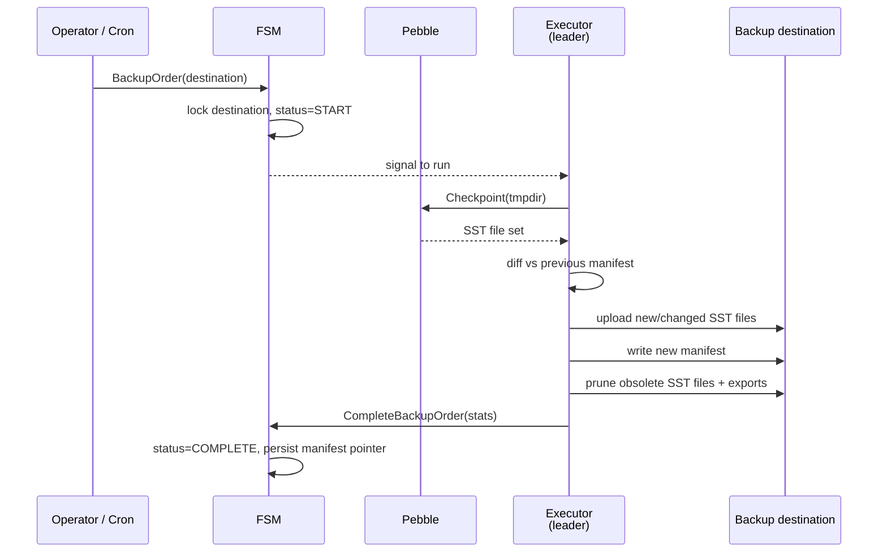

# Backup and Restore

## Overview

A **backup** is a snapshot of the **entire Pebble database**, exported to durable storage for disaster recovery: a manifest plus many SST segments, taken per destination via a Raft order (`Backup`), often scheduled.

Backups are Raft-coordinated so the cluster can't double-write to the same destination and so a failure mid-upload is recoverable.

Source: `internal/infra/backup/` (lower-level storage + manifest) and `internal/application/backup/` (FSM-side orchestration).

## Drivers

| Driver | Build tag | File |
|--------|-----------|------|
| S3 | `s3` | `internal/infra/backup/s3.go` (stub at `s3_disabled.go` without the tag) |
| Azure Blob | `azure` | `internal/infra/backup/azure.go` (stub at `azure_disabled.go` without the tag) |

`internal/infra/backup/storage.go:51-57` dispatches on the `kind` field of `StorageConfig`: only `"s3"` and `"azure"` are recognised. **There is no filesystem driver for backup** — backups must go to a real object store. The default light binary therefore has no functional backup target — operators who need backup build with `just build-full` or the matching `-tags` flag.

## Operator credential delivery

Static S3 backup credentials are referenced by Secret name/key in the Backup
namespace. The operator creates Job environment `secretKeyRef` entries, and the
kubelet resolves them for `ledgerctl`; the CLI sends the credentials in its
backup RPC using the existing storage contract. Ordinary Backup/Job/Pod specs
and S3 command arguments contain no credential values. Missing references prevent
container startup; omission preserves the Ledger server's default AWS chain.
See the [operational contract](../../../../ops/backup-restore.md#s3-credentials-for-operator-backups)
for configuration, failure behavior and Secret update timing. This changes
Kubernetes runtime delivery only, not audit state or incremental restore parity.

## Operator result recovery

Completed Jobs retain their Running reservation while result acquisition retries.
Only a parsed result persisted on the run enables successful parent accounting and
incremental scheduling. See [the recovery ordering](operator-scheduling.md#completed-job-result-recovery)
for observation failures, terminal payload failures and history pruning.

## How a backup is taken

A Pebble *checkpoint* is the engine primitive: hard-link every live SST file into a separate directory at a point in time. The checkpoint is **quasi-free** (no copy), and writes to the live database keep going untouched.

### Crash-safe write ordering and object immutability

Recoverability rests on two rules, both enforced in `internal/infra/backup/manager.go`:

1. **Ordering.** Every object the new manifest will reference is uploaded
   *before* the manifest, and *no object is deleted before* the new manifest is
   committed. Cleanup of everything the new manifest no longer references (stale
   checkpoint files, obsolete export segments, files leaked by earlier crashed
   runs) is a single orphan-prune pass that runs *after* `WriteManifest`.

2. **The prune deletes only this chain's own key shapes.** Pruning is a
   delete-by-listing, and an object-store listing by prefix also returns the
   objects of any *other* backup chain whose `bucket-id` nests under this one:
   a chain at `tenant/data/archive` is returned when the chain at `tenant`
   lists its `data/` root, and the export prune runs with no expected set at
   all. Deleting what the listing returned would therefore destroy a live
   backup, manifest included. So the prune deletes only keys this chain's own
   writers could have produced — one path segment under the root, carrying the
   content hash (`data/`) or the `.bin` suffix (`exports/`). Anything deeper
   belongs to a nested chain and is left alone, with one log line per prune
   naming how many objects were skipped. See `ownsCheckpointKey` /
   `ownsExportKey` in `internal/infra/backup/segment.go`; the recognisers are
   pinned to the key builders by `TestKeyBuildersProduceOwnedKeys`.

   This bounds the damage but does not make nesting *supported*: two chains
   sharing a prefix tree still interleave their listings, and a nested
   `bucket-id` remains a configuration smell. Give each chain a disjoint
   `bucket-id`.

3. **Immutability via content-addressing.** Checkpoint file objects are stored
   under **content-addressed keys** — `data/<filename>.<sha256>` — so any object
   a published manifest references is immutable. This matters because a Pebble
   checkpoint contains a `MANIFEST-NNNNNN` file that keeps the *same local name*
   but **grows** between checkpoints. Keying by name alone, the next full backup
   would re-upload it and overwrite the object the currently published backup
   manifest still points at, *before* the manifest swap — a crash in that window
   would corrupt the previous backup. Keying by content routes a changed file to
   a *new* key; the old object is untouched until the post-manifest prune.
   Identical content across checkpoints yields the same key, so unchanged SSTs
   are naturally deduped and skipped on re-upload (this replaces the old
   name+size diff — correctness is now the content hash, not the size).

Together these mean a crash at any point *before* `WriteManifest` leaves the
*previously published* manifest fully restorable, and a crash *after* it leaves
the *new* one restorable — there is never a window in which the current manifest
points at a deleted or half-overwritten object. A failed segment upload aborts
the run before the manifest is touched, so a partial upload can never publish a
dangling reference.

`checkpoint.files` maps each filename to its size and content-addressed storage
key. An unreadable manifest aborts backup and restore; a full backup never
overwrites it. Restore resolves objects by the recorded key.

The work is split between **Raft-coordinated lifecycle orders** (`BackupOrder`, `CompleteBackupOrder`, `FailBackupOrder` at `raft_cmd.proto:431-593`) and **executor work on the leader** (`internal/infra/backup/manager.go:40-180`). The FSM never blocks on the upload — it only records start, success, and failure.

### Per-destination mutual exclusion

Two simultaneous backups to the same destination are rejected at FSM apply time. The mutex is keyed by `CanonicalDestinationKey` — a hash of the namespace-determining fields of the `BackupDestination` (driver kind, canonicalised endpoint, bucket/container, bucket ID; region, `base_path`, and credentials are deliberately excluded, see `internal/infra/state/backup_jobs.go`). Full (`BackupOrder`) and incremental (`IncrementalBackupOrder`) backups **share the same slot**: both are routed through the leader and propose a `Start` order that lands on the same key, so a full backup and an incremental backup against the same bucket cannot run concurrently — the second gets `ErrBackupInProgress`. Two backups against genuinely distinct destinations (different bucket/endpoint) run in parallel.

This FSM-managed per-destination slot is what closes the manifest-atomicity race (EN-1055): because only one backup holds a destination at a time, the read-modify-write of the shared manifest can never interleave, so no writer can overwrite another's manifest update and orphan its segments. It is a deterministic, clock-free alternative to a leased lock — the slot is held from `Start` to `Complete`/`Fail`, and an orphaned slot (executor gone after a leadership change or crash) is freed by the leader-only cleanup loop (`internal/application/backup/cleanup.go`).

### Manifest + incremental segments

A full backup diffs the current checkpoint's SST file set against the previous manifest and uploads only the new/changed files, but always writes a fresh checkpoint manifest with an empty export set. An **incremental** backup (`IncrementalBackupOrder`) does not take a new checkpoint at all: it streams the log/audit/audit-item/applied-proposal entries written since the last recorded sequence into size-bounded export *segments* and appends them to the manifest's export list. Log and audit history is permanent in the primary store, so every export window is served from the hot store directly. Files that are no longer referenced by the newly written manifest are pruned from the destination *after* the manifest is committed (see "Crash-safe write ordering" above).

Both backup paths require the committed 32-byte audit key. A full checkpoint
includes it under `ZoneGlobal/SubGlobAuditKey`; incremental exports never
rotate or replace it. Restore preparation keeps that key and removes the
source operational cluster ID. The destination verifies and extends the
source chain with the restored key while writing later backups under its own
cluster ID namespace. Plaintext backup access reveals the key and therefore
requires the same access controls as the history it authenticates.

The manifest itself (`internal/infra/backup/manifest.go`) records:

- The Pebble checkpoint timestamp and applied Raft index.
- The last audit + log sequence numbers.
- The file map (`name → checksum → size`).
- Any exports (incremental segments not yet rolled into a checkpoint).

A fresh backup against an empty destination is just a "full" backup with an empty previous manifest. A backup right after a previous one transfers only the deltas.

## Restore

### Global key lifetimes (EN-1415)

The primary Pebble store separates durable state by restore lifetime. The
classification applies to the **whole zone**, so a new local prefix cannot be
silently carried into a different cluster:

| Pebble keys | Cross-cluster restore | Reason |
|---|---|---|
| `ZoneGlobal` / ledger info, next ledger ID, signing key/config, maintenance mode, event sink cursors/status/config, query checkpoint rows/allocator/schedule | Retained in the full checkpoint; mutable audited projections are rebuilt from the non-empty post-checkpoint delta | Business, governance, and delivery state follows the restored history. Query checkpoint rows are marked as restored because their physical directories are absent. |
| `ZoneGlobal` / `SubGlobClusterConfig` | Retained | Replicated config includes the hash algorithm used to verify the audit chain and the cache epoch; dropping it could change FSM behavior after restore. It is not a node identity. |
| `ZoneGlobal` / last applied HLC timestamp | Checkpoint value folded with the maximum timestamp of post-checkpoint audit entries | Every business proposal that advances the HLC records its effective timestamp in the audit header, including failed proposals. The next destination write must advance past the full restored history. |
| `ZoneGlobal` / idempotency eviction cutoff | Retained as a technical scan horizon | The cutoff guards cache reinjection against already committed evictions; the in-memory map is rebuilt from Pebble. |
| `ZoneClusterPersistent` (`0x08`) / applied index | Replaced by the restored genesis boundary after the zone delete | Source Raft indexes do not identify entries in the destination's log. The checkpoint index labels its new genesis snapshot. |
| `ZoneClusterPersistent` / persisted node/cluster config, peers, removed-member registry, Bloom blocks | Deleted as one range | Identity and membership belong to the source cluster. The destination writes its own config and peers and rebuilds Bloom blocks from attributes. Source removal tombstones must not blacklist destination members. |
| `ZoneClusterTransient` / backup jobs | Deleted as one range | Source in-flight jobs and their history do not coordinate destination work. |
| `ZoneCache` | Deleted as one range | Checkpoint-era cache entries may be stale after incremental replay. |

`PrepareForBackup` reads the source applied index, then stages checkpoint
markers, both cluster-only zone deletes and the new genesis boundary in one
Pebble batch. The boundary point write follows the zone tombstone. A failure
before commit leaves the store unchanged; a commit error has indeterminate
durability, and a flush error may leave the committed preparation in the store.
The restore caller must discard failed staging rather than activate it. This
changes the Pebble key layout: boot validation rejects an earlier store
through the old boot-anchor probe. There is no in-place migration of
pre-release stores. In-cluster snapshot installation retains the local zone.

For gRPC finalization, the restore service claims the single downloaded staging generation under its mutex before `PrepareForBackup`. The claim remains held through metadata reads, staging-handle closure, checkpoint publication, marker publication, and staging cleanup. A competing finalizer fails with `FailedPrecondition` before it can read or mutate the same generation. A sequential retry after success fails because the handle was cleared. `Shutdown` joins the active request before it closes retained resources.

The durable publication sequence is: prepare and read metadata from the open staging store; close its Pebble handle; create the checkpoint parent and remove an old `checkpoints/0` path; hard-link staging into a temporary directory and rename it to `checkpoints/0`; atomically write `RESTORED`; then remove staging. `RESTORED` is the commit point and always follows checkpoint placement. A preparation error leaves an open staging handle, but its Pebble writes can be indeterminate after a commit or flush error. A filesystem publication error leaves staging files with no open handle and no marker; a marker-write error additionally attempts to remove the placed checkpoint. Cleanup failure after the marker is logged and does not revoke success. Recovery from an unsuccessful finalization requires a fresh restore-mode download and validation, with any leftover checkpoint removed if rollback failed; the same in-process staging generation cannot be retried after its handle was closed.

`internal/infra/backup/restore.go` is the entry point. The flow is conceptually the inverse:

1. Read the manifest from the destination.
2. Download every checkpoint file the manifest references into a fresh Pebble
   directory. Each download is checked with `CheckpointFile.CopyVerified`: the
   object must have exactly the manifest's `size` and its sha256 must equal the
   hash embedded in its content-addressed key. A damaged, truncated, or
   replaced object fails the download and names the file. This check detects
   object corruption; it does not authenticate the manifest itself.
3. Apply any incremental exports on top (`ApplyExports`).
4. Reconstruct post-checkpoint derived state from the exported log and audit streams (`RebuildDelta`).
5. Boot the node against the restored directory.

Offline `ledgerctl store bootstrap` downloads checkpoint files through
`downloadBootstrapCheckpoint` in `cmd/ledgerctl/store/bootstrap.go`. It creates
or opens the operator-selected data directory and inspects `restore-staging`
through that root with `Lstat`. A symlink or non-directory is rejected; absence
is allowed. Any old real staging directory is removed with rooted `RemoveAll`,
then a strict rooted `Mkdir` creates the fresh directory before `OpenRoot`.
All staging-root symlinks are rejected, including targets
inside the data directory, because later finalization walks the staging path
without following a root symlink. Staging is reset even when the manifest
contains exports only. The command assumes exclusive offline use of the target;
resetting stale staging costs O(stale entries) before the complete download and
replay. A reset error stops before replay or publication and can leave old staging
partly removed or absent.

For each checkpoint map key, the downloader applies `filepath.FromSlash` and
`filepath.IsLocal` before rooted parent creation, remote lookup by the separate
content key, and rooted file creation. `os.Root` confines the final create even
when a parent or leaf is a symlink. Downloads remain sequential and use
`CheckpointFile.CopyVerified`; locality does not replace size/hash verification.
This is a per-entry boundary, not a whole-manifest transaction. On failure,
earlier files and partial file bytes can remain in staging; offline bootstrap
does not automatically wipe failed downloads. Directory handles close before
export replay, preview, optional Checker validation, confirmation and
finalization; a download failure reaches none of those steps. A rebuild failure
or confirmation EOF can leave new partial or fully rebuilt staging. Every retry
recreates it from the backup, preventing additive projection replay on a prior
attempt's committed batches. Negative confirmation attempts staging removal.
Fresh-target admission still rejects a `RESTORED` marker and live database and
reclaims a lone unmarked checkpoint 0. Finalization closes the prepared store,
rereads metadata, places checkpoint 0 via temporary-directory hard links and
rename, writes the atomic `RESTORED` commit marker, then removes staging. Marker
failure attempts checkpoint rollback; cleanup failure after the marker only warns.
This changes no persisted format or wire contract and does not repair a finalized
corrupt restore.

Each export object must terminate with its explicit stream footer at the exact
end of the object and match the manifest byte size. Its keys must belong to
the declared type and range, be ordered, and cover every sequence for log,
audit, and audit-item segments. Applied-proposal sequences may be sparse because
failed proposals have no applied-proposal row. Physical EOF, trailing bytes,
size mismatch, empty segment, or missing sequence fails the download before
the staging restore can be considered successful. `ApplyExports` writes large segments in
bounded Pebble batches, so batches committed before a later read failure can
remain until the caller discards or retries that staging directory. The gRPC
download job wipes staging on failure and never enables finalization; an
offline retry discards the entire prior staging directory and starts again from
the checkpoint (or an empty store for export-only manifests) before replay.

`RebuildDelta` is a second fold of committed effects: the checkpoint contains
projection values only up to its sequence boundary, while later incremental
segments carry the evidence needed to reconstruct their updates. Any persisted
state that can change after the checkpoint must therefore follow the
[incremental restore contract](incremental-restore-contract.md). A restore test
that has no post-checkpoint export does not exercise this path.

`RebuildDelta` also mirrors the DeleteLedger cascade: the live apply removes a
deleted ledger's projections in the same apply, and the replay issues the same
range deletes so the restored store does not resurrect them.

Prepared queries are rebuilt from their exported create, update, and delete
logs. Creates contain the complete definition. Updates carry only the new
filter, so replay seeds the target and name from the checkpoint definition (or
an earlier create in the same delta), replaces the filter, and keeps that
pending value for later mutations. Deletes write a point tombstone and clear
the pending value, which also covers create-update-delete within one delta.
These mutations accumulate in the same rebuild write sessions as the other
projections. `RebuildDelta` commits every 5,000 logs and clears its pending
overlays to bound memory, then commits its audit-derived boundaries in a later
batch. Earlier batches may already contain durable prepared-query (and other
projection) mutations when a later operation fails. The current batch is
indeterminate after a commit error, and staging cleanup can itself fail, so
callers must never reuse failed staging. They must discard and recreate the
entire staging store from the checkpoint before retrying; the restore service
attempts to wipe the staging directory on failure or cancellation and logs any
cleanup failure.

Ledger IDs are a rebuilt monotonic projection. The checkpoint's
`SubGlobNextLedgerID` value seeds the fold; every `CreatedLedgerLog` in the
post-checkpoint delta raises it to at least `created_id + 1`, even if a later log
deletes that ledger. The rebuilt ledger rows and allocator are committed through
the replay write sessions before restore finalization. If replay fails, the
partially rebuilt staging store is never activated; no allocator value from that
failed attempt is served by a running node. Live creation and replay both reject
`MaxUint32` before allocation, because accepting it would wrap the persisted
next-ID counter to zero and allow an identifier to be reused.

`CheckStore` does not currently verify `SubGlobNextLedgerID`: the counter is a
deterministic fold of the audit-chained `CreatedLedgerLog` entries and is
therefore rebuildable, but no `compare*` pass re-derives it. This is a tracked
integrity gap, not a documented exemption; a checker pass comparing the stored
counter to `max(CreatedLedgerLog.id) + 1` over the primary-store history is a
follow-up.

Event sink configuration is likewise a rebuilt projection. The checkpoint's
sink keyset seeds the fold; post-checkpoint `AddedEventsSink` logs assign a
configuration and `RemovedEventsSink` logs delete it. Both mutations are staged
in the rebuild batch and become durable only when that batch commits. An error
before commit cancels the current batch, leaving the last committed rebuild
prefix for the restore lifecycle to reject rather than activating a stale
partially rebuilt store.

After the restore, the node rejoins (or initialises) the Raft cluster as a fresh peer. The standard config validation (`internal/bootstrap/config_validation.go`) verifies that the restored `cluster-id` matches the cluster the node is supposed to be joining.

The indexbuilder's `EMPTY`/`NON_EMPTY` ledger-history bytes are peer read-store state, not primary-store backup content. A restored node with a fresh read store reconstructs them by replaying the restored global log from zero; registry entries remain inactive until their `CreatedIndexLog` is reached. EMPTY ledgers promote their indexes without backfill, while NON_EMPTY ledgers schedule the normal replay. This state therefore needs no `RebuildDelta` branch: the exported log is its reconstruction evidence. Normal same-node restarts retain the byte atomically with the read-index cursor, and query checkpoints include it because they checkpoint the read store itself.

A restore is **a node-level disaster-recovery operation**, not an in-cluster operation — it is not driven by a Raft order. Operators script it (or invoke it via the Operator) when a cluster needs to be rebuilt from cold.

## Scheduling

See [Operator backup scheduling](operator-scheduling.md) for the Kubernetes
completion cursors, zero-retention behavior, and reconciliation failure ordering.

The Operator's `Backup` CRD (`misc/operator/api/v1alpha1/`) wraps backups behind a `BackupSchedule` with **two separate cron fields** — `Full` and `Incremental` — so operators can run a full checkpoint less often than the incremental segments. The Operator submits a `BackupOrder` (full) or `IncrementalBackupOrder` at each cron tick; the FSM enforces mutual exclusion; the executor on the leader does the upload. One-off backups can also be triggered manually through the same gRPC surface.

`IncrementalBackupOrder` is the right primitive for tight RPO targets — it flushes the in-progress segment without taking a fresh full checkpoint.

## Performance characteristics

- **Pebble checkpoint is hard-link-based.** Almost no I/O cost; the live database keeps serving writes.
- **Uploads are leader-only.** Followers are not involved. This avoids fan-out but means the leader's bandwidth caps backup throughput.
- **Full-backup dedup is by content hash.** Each checkpoint file is sha256-hashed; a file whose content is already present on storage (same content-addressed key) is skipped. Pebble's compaction rewrites SSTs, so a heavily-churned database changes more file contents and re-uploads more than a quiet one — dedup is at whole-file granularity, there is no key-level diffing.
- **No backups during snapshot transfer.** A follower receiving a Raft snapshot is in a transient state; the leader does not initiate a backup while a follower is mid-sync.

## What backup doesn't do

- **It does not provide point-in-time queries.** A backup is a *Pebble* snapshot, not a logical "as of this transaction" snapshot. For point-in-time logical reads, use [query checkpoints](../read-path/query-checkpoints.md) instead.
- **It does not retain by policy.** Retention (how many manifests to keep, how long incremental segments live) is operator-driven. The system will happily back up to the same destination forever.

## Where to look in the code

| Concern | File |
|---------|------|
| FSM lifecycle orders (Backup, IncrementalBackup, Complete, Fail) | `misc/proto/raft_cmd.proto:431-593` |
| FSM-side orchestration | `internal/application/backup/orchestrator.go` |
| Backup manager (Pebble checkpoint, diff, upload) | `internal/infra/backup/manager.go:40-180` |
| Manifest | `internal/infra/backup/manifest.go` |
| Storage abstraction (S3 / Azure) | `internal/infra/backup/storage*.go` |
| Restore orchestration | `internal/infra/backup/restore.go` |
| Delta projection rebuild | `internal/infra/backup/rebuild.go`, `internal/domain/replay/` |
| `Backup` / `BackupRun` CRDs | `misc/operator/api/v1alpha1/` |

Operational cluster policy is retained in full checkpoints. Incremental manifests
carry a separate policy snapshot even if no business history changed; restore
applies it after legacy log rebuilding. See the
[policy restore contract](incremental-restore-contract.md#operational-cluster-policy).
