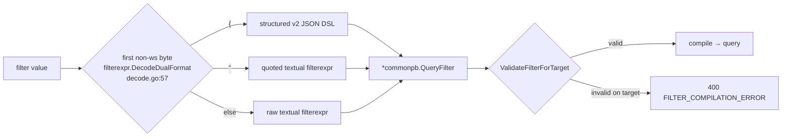

# Query Filtering — the canonical QueryFilter surface

## 1. Overview

Every migrated filtered endpoint accepts one `filter` query parameter. That
parameter has two interchangeable serializations:

- a **textual** `filterexpr` grammar; and
- a **structured** v2 JSON DSL.

Both serializations compile to the same `*commonpb.QueryFilter` and pass the
per-target validity gate `domain.ValidateFilterForTarget`. Over HTTP a caller
may send either form; the parser sniffs the first non-whitespace byte to decide
how to decode (`filterexpr.DecodeDualFormat`, `internal/pkg/filterexpr/decode.go:57`).
gRPC consumes the structured proto only — the client pre-parses the textual form
into a `*commonpb.QueryFilter` before the call.



## 2. Parameter classification

Every query parameter on every filtered endpoint plays exactly one role. The
master table below classifies them; the **Status** column records each endpoint's
relationship to the canonical `filter` surface (`canonical`, `option-only`, or the
`body-driven` prepared-query path). Every list/aggregation endpoint that selects by
account, transaction, or log is now on the canonical surface.

| Endpoint | Canonical `filter` | Typed coercion | Pagination | Endpoint/output options | Status |
|----------|---|---|---|---|---|
| `GET /v3/{ledger}/accounts` | filter (ACCOUNTS) | — | `after`(addr), `pageSize`, `reverse` | — | canonical |
| `GET /v3/{ledger}/transactions` | filter (TRANSACTIONS) | `startDate`,`endDate` | `after`(txID), `pageSize`, `reverse` | — | canonical |
| `GET /v3/{ledger}/logs` | filter (LOGS) | `startDate`,`endDate` | `after`(logID), `pageSize` | — | canonical |
| `GET /v3/_/audit-entries` | filter (AUDIT) | — | `after`(seq), `pageSize`, `reverse` | — | canonical |
| `GET /v3/{ledger}/volumes` | filter (ACCOUNTS) | — | — | `useMaxPrecision`, `collapseColors`, `groupByPrefixes` | canonical |
| `GET /v3/{ledger}/accounts/{addr}` | — | — | — | `collapseColors` | option-only |
| `GET /v3/_/indexes/status` | — | — | — | `ledger` | option-only |
| `GET /v3/_/indexes` | — | — | — | `scope` | option-only |
| `.../indexes/{id}/inspect` | — | — | `cursor`, `pageSize` | `mode` | option-only |
| `analyze-accounts` / `analyze-transactions` | — | — | — | `variableThreshold` | option-only |
| prepared-query `execute` | — (stored; see note) | — | `cursor`, `pageSize` | `parameters`, `mode` | body-driven |

The four roles:

- **canonical filter** — a dual-format `QueryFilter` (textual or structured JSON)
  compiled against the endpoint's target and gated by `ValidateFilterForTarget`.
- **typed coercion** — an RFC3339 date shorthand (`startDate`/`endDate`) coerced
  into a builtin timestamp/date range.
- **pagination** — opaque/typed cursor controls (`after`/`cursor`/`reverse`/`pageSize`),
  default page 100, capped at 1000.
- **endpoint/output option** — shapes output or scope, not selection.

> **The prepared-query `filter` is not a request parameter.** A prepared query's
> `filter` is defined once on the create/update path
> (`CreatePreparedQueryRequest.query` / `UpdatePreparedQueryRequest.filter`,
> `misc/proto/bucket.proto`) and stored server-side. The `execute` body
> (`internal/adapter/http/handlers_execute_prepared_query.go:32`) carries **no**
> `filter` — only `parameters` (bind values for the stored definition),
> pagination (`cursor`, `pageSize`) and `mode`. A `filter` sent at execute time
> is silently ignored.

## 3. Textual vs structured expressiveness

The two serializations cover the **same fields under the same names**. A bare
field name is resolved against the query target in both decoders
(`filterexpr.Parse` and `commonpb.DecodeQueryFilterJSON`), and both reject the
same names off their target. `TestDualFormatFieldParity`
(`internal/pkg/filterexpr/parity_test.go`) locks the pairing: every row decodes to
the identical proto in both forms, and `filterexpr.Format` emits text that parses
back to that proto. A new filter field must be added to both decoders, to
`Format`, and to that table in the same change.

| Field | Target | Textual | Structured JSON |
|---|---|---|---|
| `metadata[<key>]` | accounts, transactions | `metadata[k] == v`, `>`, `between`, `exists`, `in` | `$match`, `$gt`…, `$exists` |
| `address` / `source` / `destination` | accounts, transactions | `==`, `^=`, `in` | `$match` (trailing `:` = prefix) |
| `has asset` | accounts | `has asset USD/2` | `{"$exists":{"asset":"USD/2"}}` |
| `reference` | transactions | `reference == "ref-1"`, `in (…)`, `$param` | `{"$match":{"reference":"ref-1"}}` |
| `reverted` | transactions | `reverted == true` | `{"$match":{"reverted":true}}` |
| `id` | transactions | `id == 3`, `>`, `between` | `{"$match":{"id":3}}`, `$gt`… |
| `timestamp`, `insertedAt`, `revertedAt` | transactions | `insertedAt >= "2023-11-14T22:13:20Z"` | `{"$gte":{"insertedAt":"…"}}`, `$match` |
| `logId` | logs | `logId == 7`, `>`, `between` | `{"$match":{"logId":7}}`, `$gt`… |
| `date` | logs | `date >= "…"` | `{"$gte":{"date":"…"}}`, `$match` |
| `ledger` | logs | `ledger == main`, `$param` | `{"$match":{"ledger":"main"}}` |
| audit fields (§7) | audit | `outcome == failure`, `seq between 1 and 9` | `{"$match":{"outcome":"failure"}}`, `$gte`… |

On the uint fields, `$match` is an equality: it decodes to the closed range from the
value to itself, the proto textual `==` builds. A closed range written as two bounds
(`id > 3 and id < 9`, or a JSON `$and` of `$gt` and `$lt`) folds into one range
condition in both decoders.

A bound of a non-audit uint range (`id`, `timestamp`, `insertedAt`,
`revertedAt`, `logId`, `date`) may be a parameter in both forms: textual
`id >= $from` and structured `{"$gte":{"id":{"$param":"from"}}}` decode to the
same `ParamMin`, resolved when a prepared query executes. `Format` renders a
parameter bound as `$name`, so a parameterized range survives the
`ledgers configuration export` / `apply` round-trip; a literal and a parameter
bound can be mixed (`id >= 3 and id <= $hi`). The audit fields take literal
operands only: audit reads have no parameter-resolution context.

The remaining asymmetries are operator-level, not field-level:

| Capability | Textual | Structured JSON | Why |
|---|---|---|---|
| Byte-level address prefix | `address ^= "users"` | only a prefix ending `:` → `{"$match":{"address":"users:"}}` | the JSON DSL has no prefix operator (`$like` was dropped, EN-1465) |
| Audit `idempotency_key` prefix | `idempotency_key ^= "import-"` | *(none)* | same |

## 4. Removed aliases → canonical replacements

The following convenience aliases have been **removed** (not deprecated — they no
longer exist):

- `prefix=` (accounts) → `filter=address ^= "users:"` (textual) or the structured
  `{"$match":{"address":"users:"}}`.
- `prefix=` (volumes, EN-1541) → the same `filter=address ^= "users:"`. The
  dual-format `filter`, compiled for the Accounts target, is now the sole account
  selector on `GET /v3/{ledger}/volumes`; the aggregation options
  (`useMaxPrecision`, `collapseColors`, `groupByPrefixes`) are unaffected.
- `reference=` (transactions) → `filter=reference == "ref-1"` (textual) or the
  structured `{"$match":{"reference":"ref-1"}}`.

URL-encoded, the two reference replacements are:

```http
GET /v3/{ledger}/transactions?filter=reference%20%3D%3D%20%22ref-1%22
GET /v3/{ledger}/transactions?filter=%7B%22%24match%22%3A%7B%22reference%22%3A%22ref-1%22%7D%7D
```

## 5. Combination semantics

Multiple filter inputs combine with a **pure AND** (`combineFilters`,
`internal/adapter/http/list_filter.go:56`). There is no conflict detection and no
cross-condition normalization. `startDate`/`endDate` AND-combine with the `filter`
parameter. `$or`/`$not` exist only *inside* a single filter expression — they do
not compose across separate query parameters.

A combinator over **zero** operands follows the algebra: `And{}` is vacuously
true and selects the whole target universe (the same rows as no filter at all),
`Or{}` is vacuously false and selects nothing. The compilers
(`compileAnd`/`compileOr` and their descending twins) and the audit compiler
(`compileAuditAnd`) all agree on this. The zero-operand form is reachable over
gRPC only: both serializations of the REST surface require at least one operand
per combinator (`decodeCombinator`, `internal/proto/commonpb/query_filter.go`).

On ACCOUNTS, "the universe" is the main store's volume ∪ metadata rows
(`NewPebbleAccountIterator`), and two leaves reach past it. A drained ephemeral
account keeps its monotonic `abya` row after `applyEphemeralPurge` deletes its
volume row, so `has asset` serves an account that the universe scan omits — the
split the ACCOUNTS horizon carve-out exists to preserve
(`MainHorizonKeep`). A conjunction that acquires a universe operand therefore
intersects that split away: `has asset X and And{}` selects fewer accounts than
`has asset X` alone. `not` acquires one the same way — `compileNot` builds
`NotIterator(universe, child)` — so `has asset X and not address == "<absent>"`
narrows identically, and does so independently of any empty combinator.

## 6. Typed date coercion

`startDate`/`endDate` are RFC3339-only convenience shorthands that map to a
builtin timestamp/date range. They are not the only way to express a date bound:
the DSL `date`/`timestamp` fields **also** accept RFC3339 (EN-1544) *and* raw
microseconds. Pre-epoch values are rejected (EN-1542). Do not read this section as
"the structured DSL lacks date coercion" — it does not; only the top-level
`startDate`/`endDate` query parameters are restricted to RFC3339.

## 7. Audit

The audit target has its own bare field vocabulary
(`commonpb.LookupAuditField`, shared by both decoders): `outcome`, `ledger`,
`caller_subject`, `order_type`, `idempotency_key` (strings: `==`/`in`, or
`$match`), and `seq`, `proposal_id`, `log_seq`, `timestamp` (uints, `timestamp`
also RFC3339: `==`/ranges/`between`, or `$match`/`$gt`…). On
`QUERY_TARGET_AUDIT` these names win over the colliding transaction/log meanings
of `ledger` and `timestamp` (EN-1549): `ledger == main` and
`{"$match":{"ledger":"main"}}` are both the audit ledger condition there. Audit
conditions take no `$param` (audit reads have no parameter context), and only the
textual form has the `idempotency_key ^=` prefix match.

The JSON **encoder** (`QueryFilter.MarshalJSON`) has no target, so it refuses audit
conditions rather than emit a node that would decode back to the wrong arm through
the target-independent `UnmarshalJSON`. No JSON-encoded filter is audit-targeted:
prepared queries are never audit queries.

---

**Source of truth.** The per-target validity table is
`internal/proto/commonpb/common_queryfilter_validity.pb.go`; the parse entry point
is `internal/pkg/filterexpr/decode.go`.
